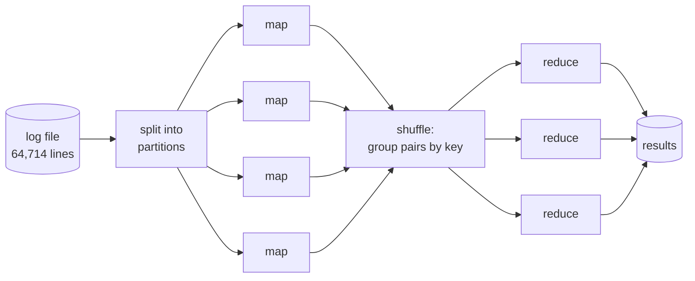

# Week 7 exercise: MapReduce on real web logs

* CMKL 41-645 Software Engineering for AI-Enabled Systems
* Week 7: Scaling the System

**Individual work · about 50 minutes**

## Learning outcomes

By the end of this exercise, you should be able to:

1. Write a mapper and a reducer for a counting job, and explain what the shuffle does in between.
2. Make a mapper robust to the messy lines found in real data.
3. Explain why map and reduce steps must be free of side effects, and fix a job that is not.

## Scenario

In the lecture, the photo service counted views per photo from its web-server logs with MapReduce. In this exercise you do the same with **real logs**: every request made to the NASA Kennedy Space Center web server on **1 July 1995**, while Space Shuttle mission STS-71 was in orbit. That day, 64,714 requests asked for pages and images such as the shuttle countdown clock, the STS-71 mission patch and Apollo mission photos.

A small **MapReduce engine** is already written for you. It does on one computer what Hadoop or Spark does on a cluster:



You write only the two functions that differ from job to job:

```python
def mapper(line):           # ONE log line  ->  zero or more (key, value) pairs
    yield key, value

def reducer(key, values):   # ONE key and ALL of its values  ->  one result
    return result
```

With `--workers 4`, the engine maps the partitions in 4 separate processes at the same time, the way a cluster would on 4 machines.

### The data

Each line of the log is one request, in the standard format used by most web servers:

```text
199.72.81.55 - - [01/Jul/1995:00:00:01 -0400] "GET /history/apollo/ HTTP/1.0" 200 6245
└── host ──┘      └────── time ─────────┘  └─────── request ──────────┘ └┬┘ └┬─┘
                                                                     status  bytes
```

You do not need to take lines apart yourself: `parse_line(line)` in `mapreduce/logparse.py` does it and returns a dict such as

```python
{"day": 1, "hour": 0, "method": "GET", "path": "/history/apollo/", "status": 200, "bytes": 6245}
```

or **`None` if the line is malformed**. Real logs always contain a few broken lines (this day has 43), so every mapper must handle `None`.

Useful status codes: **200** OK (the server sent the file), **304** Not Modified (the browser already had it in its cache, nothing was sent), **404** Not Found.

| File | What it is |
|---|---|
| `data/nasa_1995-07-01.log` | All 64,714 requests of 1 July 1995 (7 MB). |
| `data/sample.log` | 23 real lines from the same day, used by the tests. Small enough to check by hand. |

> The logs come from the [Internet Traffic Archive](https://ita.ee.lbl.gov/html/contrib/NASA-HTTP.html), which allows them to be redistributed. The providers ask that they are used only to study general traffic patterns. That is why `parse_line` does not return the host: none of the tasks look at who visited.

### The files

| File | What it does | Do you edit it? |
|---|---|---|
| `mapreduce/engine.py` | The MapReduce engine: split, map, (combine), shuffle, reduce. | No, but read its docstring. |
| `mapreduce/logparse.py` | `parse_line(line)`: one log line → dict, or `None`. | No. |
| `run_job.py` | Runs a job and prints statistics and results: `python3 run_job.py <job> [--workers N] [--partitions N] [--input FILE]`. | No. |
| `jobs/views_per_image.py` | Views per image. | **Task 1** |
| `jobs/megabytes_per_hour.py` | Data sent per hour of the day. | **Task 2** |
| `jobs/distinct_pages_per_hour.py` | Different pages requested per hour. Written by a colleague; it has a bug. | **Task 3** |
| `tests/` | One test file per task. They use `data/sample.log`. | No. Make them pass. |
| `.github/workflows/tests.yml` | On every push, GitHub runs the tests, then runs all three jobs on the real day. | No. |
| `stretch/`, `tools/` | Stretch goals. | Only if you finish early. |
| `REFLECTION.md` | Three short questions. | **Yes**, at the end. |

---

## 0. Setup (5 min)

1. **Fork** this repository (top right on GitHub) into your own account, and enable Actions on your fork: open the **Actions** tab and click **"I understand my workflows, go ahead and enable them"**.
2. Get a terminal with Python. Pick **one** option:
   - **Your machine** (Python 3.9 or newer):
     ```bash
     git clone https://github.com/<your-username>/se4ai-mapreduce.git
     cd se4ai-mapreduce
     python3 -m venv .venv            # Windows: py -m venv .venv
     source .venv/bin/activate        # Windows: .venv\Scripts\activate
     python3 -m pip install --upgrade pip
     python3 -m pip install -r requirements.txt
     ```
   - **No Python installed?** On your fork, click **Code → Codespaces → Create codespace on main**. Everything is installed for you, including Dask for the stretch goal.
3. Run the tests. They should all fail for now: you have not written anything yet.
   ```bash
   python3 -m pytest -q
   ```

> **Stuck?**
> - **Windows:** type `python` wherever this README says `python3` (after you activate the virtual environment). Use `py` only to create it.
> - Always run commands from the repository root (the folder with this README).

---

## Task 1. Views per image (15 min)

Open `jobs/views_per_image.py` and write `mapper` and `reducer`. A request counts as a **view of an image** when:

- the line can be parsed (`parse_line` does not return `None`);
- the method is `GET`;
- the status is `200`;
- the path ends in `.gif`, `.jpg` or `.jpeg`, **in any letter case**. Many of the mission photos on this server are called things like `/history/apollo/apollo-13/images/70HC314.GIF`.

The mapper looks at **one line** and yields `(path, 1)` for a view, nothing otherwise. The reducer gets one path and the list of all its values, such as `[1, 1, 1]`, and returns the total.

Check your work:

```bash
python3 -m pytest tests/test_views_per_image.py
python3 run_job.py views_per_image
```

All tests should pass, and the job should print:

```text
input            64,714 lines in 4 partitions, 1 worker(s)
map              33,665 pairs emitted
shuffle          33,665 pairs sent, 719 distinct keys
time               ...

/images/NASA-logosmall.gif                         3,350
/images/KSC-logosmall.gif                          3,102
/shuttle/countdown/count.gif                       2,492
...
```

Now run it again with `--workers 4`. The results must be **exactly the same**: splitting the work differently may change the speed, never the answer.

Look at the statistics: 64,714 lines became 33,665 pairs, which the shuffle grouped into 719 keys, so the reducer ran 719 times. On a cluster, those 33,665 pairs travel over the network during the shuffle.

> **Stuck?**
> - A mapper that yields nothing can simply `return`.
> - `path.lower().endswith((".gif", ".jpg", ".jpeg"))` takes a tuple of endings.
> - `test_mapper_counts_upper_case_extensions` fails? See the last bullet of the rules above.
> - `TypeError: 'NoneType' object is not subscriptable`: you used the result of `parse_line` without checking for `None`.

---

## Task 2. Megabytes per hour (10 min)

The operations team wants to know **when the peak load is**, to plan capacity. Open `jobs/megabytes_per_hour.py` and write a job whose key is the **hour of the day** (0–23) and whose result is the **total data sent in that hour, in megabytes** (1 MB = 1,000,000 bytes), rounded to 1 decimal.

This time, count **every request** that can be parsed, whatever its method or status (`parse_line` already turns a missing size `-` into `0`).

```bash
python3 -m pytest tests/test_megabytes_per_hour.py
python3 run_job.py megabytes_per_hour
```

The job prints all 24 hours. Hour `0` should be `81.0`. **Which hour has the peak, and how big is it?** Write it down for the reflection.

> **Stuck?**
> - The mapper yields `(request["hour"], request["bytes"])`.
> - `round(x, 1)` rounds to 1 decimal.
> - Divide in the **reducer**, once, not in the mapper.

---

## Task 3. A job that depends on how it is run (15 min)

A colleague wrote `jobs/distinct_pages_per_hour.py`: for every hour, it counts how many **different** HTML pages were requested. To make the shuffle smaller, they "optimized" the mapper so it never sends the same page twice. Read the job, then run it twice:

```bash
python3 run_job.py distinct_pages_per_hour --workers 1
python3 run_job.py distinct_pages_per_hour --workers 4
```

1. Compare the two outputs. Hour `0` is the same in both. What about the other hours? Which run is right?
2. Run the tests: `python3 -m pytest tests/test_distinct_pages_per_hour.py`. Most fail, but **one case passes**. Look at which partitions and workers it uses. Why might the buggy job happen to get it right?
3. Find the cause. Hint: where does `already_sent` live, and what happens to it when the mapper runs in one process, in several processes, or twice in a row?
4. Fix the job so that **the mapper looks at one line only** and keeps no state between lines. Where should the "count each page only once" logic go instead?

When it is fixed, all its tests pass, and both commands print the same numbers, starting:

```text
0             133
1             129
2             124
```

> **Stuck?**
> - The mapper should yield `(hour, page)` for every `.html` request, even if the page was seen before.
> - The reducer gets **all** pages for one hour. `len(set(values))` counts the different ones.
> - This is the rule from the lecture: map and reduce steps must be **free of side effects**, so the infrastructure can split, move and re-run them, for example after a machine fails.

---

## Push and check (2 min)

Commit and push your work:

```bash
git add -A
git commit -m "Write MapReduce jobs"
git push
```

Open the **Actions** tab of your fork. The **mapreduce-tests** run installs Python, runs `pytest`, then runs your three jobs on the real day. It should be green.

> **Stuck?** If `git push` asks for a password, use the Codespace, GitHub Desktop, or sign in with `gh auth login`.

## Reflection (3 min)

Answer the three questions in [`REFLECTION.md`](REFLECTION.md), then commit and push.

## How to submit

Submit the URL of your fork. Your fork should show:

- [ ] a **green** mapreduce-tests run on the latest commit;
- [ ] `REFLECTION.md` filled in.

---

## Stretch goals (if you finish early)

### A. Shrink the shuffle with a combiner (5 min)

A **combiner** runs on each partition's output **before** the shuffle, to pre-aggregate it. The engine calls it if your job defines `combiner(key, values)`.

1. In `jobs/views_per_image.py`, add `combiner = reducer` at the bottom and run the job again. Compare the `shuffle ... pairs sent` line with Task 1. The results must not change.
2. Why is it safe to reuse the reducer as a combiner here? Would `combiner = reducer` give the right answer in `megabytes_per_hour` (think about the rounding) or in `distinct_pages_per_hour`?

### B. Run your job on Dask (15 min)

[Dask](https://www.dask.org/) is a Python library that splits data into partitions and runs tasks on many processes, on one laptop or on a cluster of machines. It needs **Python 3.10 or newer**; the Codespace already has it installed.

```bash
python3 -m pip install -r requirements-stretch.txt   # skip in the Codespace
python3 stretch/dask_views.py
```

The script runs Task 1 three ways and checks that they agree:

- **A.** the course engine with your functions;
- **B.** Dask, calling **your** `mapper` and `reducer` unchanged;
- **C.** Dask written "the Dask way". Complete `views_dask_style()` in `stretch/dask_views.py` using `map`, `filter`, `pluck` and `frequencies`.

While it waits for you to press Enter, open the **Dask dashboard** (the link it prints; in a Codespace, open port **8787** from the **Ports** tab) and look at the task stream. Then compare B and C: B uses `groupby`, a full shuffle of every pair, while `frequencies()` combines counts inside each partition first, like your combiner in stretch goal A.

### C. Scale up to the whole month (10 min)

```bash
python3 tools/download_full_month.py
python3 run_job.py views_per_image --input data/full/nasa_1995-07.log --partitions 8 --workers 1
python3 run_job.py views_per_image --input data/full/nasa_1995-07.log --partitions 8 --workers 4
```

The download is 20.7 MB and the archive's server can be slow. The file stays on your machine (`data/full/` is not committed). Compare the `map` times. Why does the map step get faster with more workers, but not 4 times faster?

---

## In industry

The engine in this exercise is a teaching tool. In industry, batch jobs like these usually run on **[Apache Spark](https://spark.apache.org/)**, often as a managed service such as Databricks, Amazon EMR or Google Dataproc. Spark follows the same ideas you used here (partitions, map steps that run next to the data, a shuffle by key, side-effect-free steps that can be re-run), with a richer API, in-memory processing and SQL on top. MapReduce on Apache Hadoop is its predecessor and still runs in many older data platforms.
